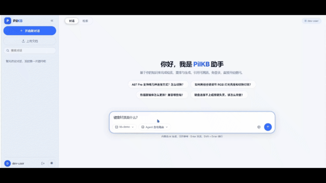

# PilKB

企业级 RAG（检索增强生成）知识库问答平台：文档上传后自动完成解析、清洗、切分与索引，问答时经向量 + BM25 混合检索、Cross-Encoder 重排，以 SSE 流式输出带引用来源的回答。内置多知识库 ACL、JWT 鉴权、限流、MCP Server 与 Docker 一键部署。

```
上传:  PDF/Word/MD/TXT/图片 ──► 解析 ──► 42 条规则清洗 ──► 自适应切分 ──► HyDE 元数据
                                                                    │
                                                                    ▼
                                                   ChromaDB (向量) + BM25 (关键词)
                                                                    │
问答:  问题 ──► 查询改写/HyDE ──► 混合检索 (RRF 融合) ──► 父文档召回 ──► 重排 (Top-60→Top-25)
                                                                    │
                                              RAG 直接拼 Prompt / Agent 工具循环
                                                                    │
                                                     SSE 流式回答 + 引用溯源
```

## 演示

<p align="center">
  
</p>

本地复现完整链路（无需 API Key）见下方「快速开始 · 方式一」。

## 功能特性

**文档与检索**

- 多格式入库：PDF（pypdf）、Word（python-docx）、Markdown / 纯文本、图片 OCR（pytesseract，中英文；未装引擎时自动降级）；单文件默认上限 25 MB
- 确定性清洗：42 条正则规则去噪（控制字符 / 零宽字符 / HTML / Markdown / LaTeX 残留 / 页眉页脚 / 脚注 / 目录点线…），幂等、零成本
- 自适应切分：短文档整篇保留为单 chunk，长文档按 `adaptive_chunk_size` 递归切分并保留 overlap
- 混合检索：ChromaDB 向量 + jieba 分词 BM25 双路召回，RRF 融合；Chroma 在个别平台不可用时可切 `numpy` 后端兜底
- 检索质量优化：入库 / 查询双侧 HyDE、父文档（兄弟 chunk）连坐召回、重排候选池收窄、LLM 查询改写，均可经配置开关单独启停，便于消融对比

**问答与 Agent**

- 两种问答模式：`rag`（检索结果直接拼 Prompt）与 `agent`（LangGraph ReAct 工具调用循环，模型自主组织检索词、结果不佳时换词重试）
- Agent 工具集：`hybrid_search`（混合检索）、`calculator`、`current_date`；轮数预算耗尽自动用已收集证据兜底生成
- 会话记忆：带 `session_id` 的请求按 `{user}:{session}` 隔离累积上下文；checkpoint 落盘 SQLite（AsyncSqliteSaver），后端重启后历史会话仍可继续
- SSE 流式输出，回答附带 `[1] [2]` 编号的引用来源与得分

**多知识库与权限**

- 多 kb 隔离：向量库 / BM25 / 上传文件均按 kb_id 分目录持久化；每用户私有 kb 数上限默认 10
- ACL：`PUBLIC_KB_IDS` 白名单内的公共 kb 全员可读不可写；私有 kb 仅 owner 可读写；管理员可重建公共 kb 索引

**安全**

- JWT 双通道下发：HttpOnly Cookie（前端自动携带）+ Bearer 头（脚本 / 第三方）；登出即吊销
- 限流：登录失败 5 次 / 5 分钟锁定 15 分钟；chat 20 次 / 分钟 / 用户；注册与上传分别按 IP / 用户限速
- 生产自检：`APP_ENV=prod` + 默认 JWT secret 时进程拒绝启动（fail-fast）
- 安全响应头（CSP / HSTS / nosniff / DENY / referrer-policy）、CORS 白名单（禁止 `*` + credentials）、可配置的 XFF 信任代理

**工程化**

- 启动自检：Chroma 冷启动预热 + BM25 / 向量库数量一致性巡检（不一致时给出修复端点指引）
- 可观测性：loguru 结构化日志，可选接入 LangFuse 追踪（trace / span / generation 三层）
- MCP Server：把内部检索工具以 Model Context Protocol (stdio) 暴露给 Claude Desktop / Cursor 等客户端
- 500+ 项 pytest 测试，覆盖检索缓存、并发竞态、清洗回归、上传容错、安全断言等

## 技术栈

| 层 | 选型 |
|---|---|
| 后端 | Python 3.11–3.13 / FastAPI / LangChain + LangGraph / SQLAlchemy |
| 检索 | ChromaDB（向量）、rank-bm25 + jieba（关键词）、sentence-transformers（Embedding 与 Cross-Encoder 重排） |
| 前端 | Next.js 14 (React 18) / TypeScript |
| 存储 | SQLite（默认）/ PostgreSQL（可选）/ Redis |
| 部署 | Docker / Docker Compose |

Embedding 与重排均支持 `local`（本机加载模型）和 `api`（OpenAI 兼容 / Cohere 风格接口）两种后端，按部署条件组合。

## 快速开始

### 方式一：零配置演示（推荐先跑通链路）

不需要任何 API Key，用内置假实现走完整 RAG 链路：

```bash
cp .env.example .env          # Windows: copy .env.example .env
# .env.example 默认已带 PILKB_FAKE_LLM=1 / PILKB_FAKE_EMBEDDING=1
uvicorn app.main:app --port 8000
python run_demo.py            # 上传示例文档 + 单轮问答 + 流式问答
```

配好真实 API Key 后，把这两项改回 `0`，用 `python run_chat_real.py` 验证真实 LLM 效果。

### 方式二：本地开发

```bash
python -m venv .venv
.venv\Scripts\pip install -r requirements.txt     # Linux/macOS: .venv/bin/pip
copy .env.example .env                            # 编辑 .env: 填 LLM key、按需调整
.venv\Scripts\python -m uvicorn app.main:app --port 8000
```

```bash
cd frontend
npm install
npm run dev        # http://localhost:3000
```

- Swagger 文档：<http://localhost:8000/docs>
- 健康检查：<http://localhost:8000/health>

Windows 用户也可以直接双击 `start_pilkb.bat`：自动创建 `.env`、安装前端依赖、预检端口、起后端 + 前端两个窗口并打开浏览器。

### 方式三：Docker Compose

```bash
cp .env.example .env          # 按需修改（生产务必换掉 JWT_SECRET）
docker compose up -d                                # backend + frontend + redis
docker compose --profile pg up -d                   # 额外启用 PostgreSQL
docker compose --profile observability up -d        # 额外启用自托管 LangFuse (localhost:3001)
```

> **为什么单 worker**：BM25 是"进程内存 + 整表覆盖落盘"的形态，Chroma 走本地 sqlite，多 worker 会静默丢写入；镜像因此固定 `--workers 1`。要横向扩展需先把 BM25 外置或让 Chroma 以服务端模式独立部署。

## 配置

全部配置集中在 `.env`（见 `.env.example` 的逐项注释），关键字段：

| 配置 | 默认 | 说明 |
|---|---|---|
| `LLM_PROVIDER` | `deepseek` | `deepseek` / `qwen` / `openai`（后三者各自一组 `*_API_KEY / *_BASE_URL / *_MODEL`，可并存、按请求切换） |
| `PILKB_FAKE_LLM` / `PILKB_FAKE_EMBEDDING` | `0` | 本地演示开关，置 `1` 不请求外部模型 |
| `EMBEDDING_BACKEND` / `RERANK_BACKEND` | `local` | `local`（sentence-transformers）或 `api`（HTTP 接口，免 torch） |
| `CHUNK_SIZE` / `CHUNK_OVERLAP` | `500` / `80` | 常规切分参数；自适应切分另有 `ADAPTIVE_CHUNK_SIZE` |
| `VECTOR_STORE_BACKEND` | `chroma` | chromadb 在当前平台崩溃时可切 `numpy` 兜底 |
| `DATABASE_URL` | SQLite | 上线可换 `postgresql+psycopg2://...`（compose 的 `pg` profile 已备好） |
| `PUBLIC_KB_IDS` / `ADMIN_USERS` | `default` / 空 | 公共只读 kb 白名单 / 管理员用户名 |
| `JWT_SECRET` | 占位 | `APP_ENV=prod` 时必须是 ≥32 字符的强随机值，否则拒绝启动 |
| `UPLOAD_MAX_BYTES` | 25 MB | 单文件上限，超出返回 413 |

RAG 质量开关（`HYDE_ENABLED` / `PARENT_RECALL_ENABLED` / `QUERY_REWRITE_ENABLED` / `AGENT_ENGINE` 等）同样在 `.env.example` 中有说明与推荐值。

## API 概览

认证后的接口同时接受 Cookie 与 `Authorization: Bearer <token>`。完整定义见 `/docs`。

| 方法 | 路径 | 说明 |
|---|---|---|
| GET | `/health` | 健康检查（免认证） |
| POST | `/api/v1/auth/register` `/login` `/logout` | 注册 / 登录 / 登出吊销 |
| POST | `/api/v1/auth/dev-token` | 免注册取 token，**仅 dev 环境可用** |
| POST | `/api/v1/documents/upload?kb_id=` | 上传并入库（解析→清洗→切分→索引） |
| GET | `/api/v1/documents/list?kb_id=` | 文档列表与 chunk 数 |
| DELETE | `/api/v1/documents/{doc_id}` | 删除文档及其全部 chunk（双存储同步） |
| POST | `/api/v1/documents/rebuild-bm25?kb_id=` | 从向量库回灌重建 BM25 索引 |
| GET / POST | `/api/v1/kbs` | 列出 / 创建知识库 |
| POST | `/api/v1/chat` | 一次性问答（`mode`: `rag` / `agent`） |
| POST | `/api/v1/chat/stream` | SSE 流式问答 |
| GET / POST | `/api/v1/history` | 会话列表 / 新建会话 |
| GET / POST / DELETE | `/api/v1/history/{session_id}`… | 会话详情 / 追加消息 / 删除会话 |

调用示例（dev-token + 上传 + 问答）见 `run_demo.py` 与 `run_chat_real.py`。

## MCP 接入

把 PilKB 的检索能力暴露给 MCP 客户端（stdio 传输）：

```bash
python -m app.mcp.server default    # 参数为 kb_id, 默认 default
```

Claude Desktop / Cursor 等客户端配置示例：

```json
{
  "mcpServers": {
    "pilkb": {
      "command": "python",
      "args": ["-m", "app.mcp.server", "default"],
      "cwd": "/path/to/PilKB"
    }
  }
}
```

## 评估与消融

评测资产随仓库分发（`data/eval/`，是 `data/` 忽略规则的唯一例外）：数据集、两份合成演示语料（`data/eval/corpus/`，机械键盘产品手册 + 企业知识库演示文档）与真实运行产出的结果 JSON。

**已入库结果**（均可按下方步骤复现，出真实分数需配 LLM key）：

| 实验 | 关键结果 | 证据文件 |
|---|---|---|
| 三引擎编排消融（60 题，关键词覆盖率） | react 0.975 / router 0.922 / rag 0.925；react 较 rag **+5.0pt**（配对 bootstrap 95% CI [+0.8, +10.0]pt，显著），收益集中在 multi-hop 题（0.919→0.984，+6.5pt）；代价是端到端延迟 +2.1s（3021→5152ms，显著） | `data/eval/agent_ablation_v2.json` |
| BM25 中文分词消融（62 题，Recall@5） | 汉字整段 R@5 0.28（词表交集 24%）→ 2-gram 0.98 → jieba 0.95（索引 token −34%、零结果率最低） | `data/eval/tokenizer_ablation.json` |
| 检索路径消融（130 题，119 条计分） | 单路单 query → 双路多 query：R@5 0.807→0.840（配对 bootstrap 95% CI [+0.8, +6.7]pt，显著）、MRR@10 0.730→0.746，检索 P95 667→1247ms；LLM judge 60 题抽样方向一致（0.883→0.900） | `data/eval/ablation_retrieval.json` / `ablation_retrieval_llm.json` |
| chunk 粒度消融（4 档 × 3 路径） | 混合检索 R@1 0.63（adaptive 5500，仅 2 chunks）→ 0.81（chunk 500，23 chunks），chunk 定标 500 | `data/eval/recall_baseline_bge_m3.json` |
| 检索配置消融 × RAGAS（119 样本 × 2 配置） | faithfulness 0.885→0.889、context_precision 0.818→0.826（单路 → 多路查询；此消融只取 faithfulness / context_precision 两项） | `data/eval/ablation_ragas_summary.json` |

> **结果出处**：`ablation_retrieval*.json` 与 `ablation_ragas_summary.json` 产出于 kb-demo（文件内 `kb` 字段可查）；`kb-eval` 是按下方步骤用同一份语料重建的评测库，复现数字允许小幅波动（检索延迟受网络与 API 环境影响更明显）。三引擎消融已在 kb-eval 重跑，对应 `agent_ablation_v2.json`。

**复现步骤**：

```bash
# 1) 新建专用 kb (如 kb-eval), 仅上传 data/eval/corpus/ 两份语料
#    (前端上传页或 POST /api/v1/documents/upload; 混入其他文档会改变检索环境)
uvicorn app.main:app --port 8000

# 2) 三引擎消融 (60 题, 分题型统计 + 以 rag 为基线的配对 bootstrap; 逐题串行保证延迟可比)
python tests/run_agent_ablation.py --kb kb-eval

# 3) 检索路径消融 (文本口径, 确定性匹配; 多 query 改写走 data/eval/hyde_gen_cache.json 回放, 不烧 LLM)
python -m tests.run_retrieval_ablation --kb kb-eval \
    --out data/eval/ablation_retrieval.json

# 4) 生成侧 RAGAS 消融 (需 .env 配置 LLM key; judge 与生成共用同一 provider)
python -m tests.run_ragas_ablation --kb kb-eval
```

检索路径消融（step 3）完全不依赖 LLM，分数确定性可复现；三引擎消融与 RAGAS 消融的生成、judge 阶段消耗真实 LLM 调用。`tests/run_ragas_eval.py`（`--llm-mode fake_llm`）用于在无 key 环境验证评估脚本链路通断，其输出不代表真实模型效果，故不入库。重跑产生的报告仍落在 `data/eval/` 下，属于运行产物不入库。

## 运行测试

```bash
pytest -q
```

测试不依赖外部服务：模型 / 向量库 / BM25 / LLM 全部以 fake 注入，覆盖缓存单例、并发竞态、清洗与截断回归、上传容错、CORS 与生产安全断言等。

## 目录结构

```
PilKB/
├── app/
│   ├── agents/      # LangGraph Agent 编排 (react/router) 与工具
│   ├── api/         # REST / SSE 接口: auth, documents, kbs, chat, history, health
│   ├── core/        # 配置、安全、限流、日志、可观测性、kb 注册表
│   ├── db/          # SQLAlchemy 模型与会话
│   ├── mcp/         # MCP Server (stdio)
│   ├── rag/         # 解析 → 清洗 → 切分 → 元数据 → 混合检索 → 重排 → 评估
│   └── schemas/     # Pydantic 请求 / 响应模型
├── frontend/        # Next.js 前端 (chat / upload / sources / history)
├── tests/           # pytest 测试与评估脚本 (_fakes.py 提供全套假实现)
├── data/            # 运行时数据 (gitignore); 例外: data/eval/ 评测数据集/语料/结果随仓库分发
├── Dockerfile
├── docker-compose.yml
├── run_demo.py      # 假 LLM 演示脚本
├── run_chat_real.py # 真实 LLM 多轮验证脚本
└── start_pilkb.bat  # Windows 一键启动
```

## License

MIT，见 [LICENSE](LICENSE)。

